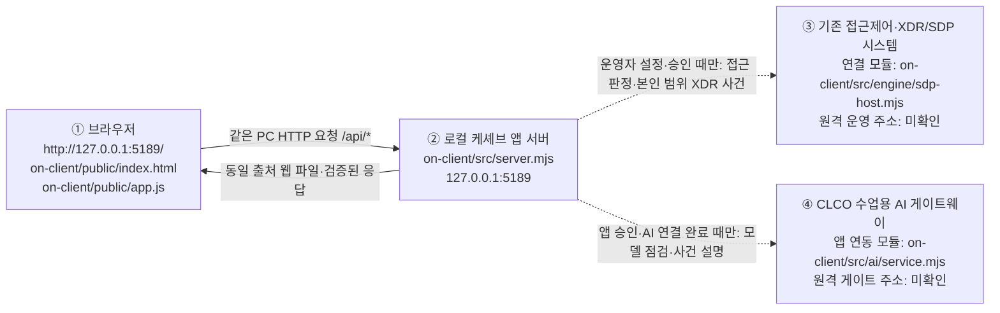

# 케셰브(KESHEV) | 학생용 실행 설명서와 시스템 구성도

> SKT ALEPH BYTE BACK 21단계 학생 작성 문서. 제공 README와 실행 안내는 수정하지 않고 보완합니다.
> **작성 상태:** 4/4단계 문서 작성 완료. **2026-11-11 새 PowerShell 창에서 환경 확인·대체 포트 실행·기본 화면·종료 후 포트 검사·재실행을 직접 확인**했습니다. 일부 버튼의 실제 기능·외부 연결은 미확인이고, **21단계 공식 평가는 미제출**입니다.

## 1. 프로젝트 목적과 대상 독자

**케셰브**는 사용자가 자신의 로그인·기기·세션 상태, 업무 앱 접근 판정, 접속 및 XDR 보안 사건, AI 설명·조치 상태, 설치 패키지의 알려진 취약점 조회 결과를 확인하도록 돕는 **보안 Agent의 학생 화면**입니다. 기존 접근 제어·XDR 시스템의 실행과 AI 게이트웨이 연동은 로컬 학생 화면과 별개의 책임입니다.

이 문서는 **다른 사람이 프로젝트를 열어 실행하고, 확인 가능한 기능과 아직 확인하지 않은 연결을 구분할 수 있도록** 작성합니다. 실제 보안 조치를 임의로 실행하거나 인증 정보를 설정하는 안내서가 아닙니다.

## 2. 문서와 구현의 경계

| 구분 | 실제 파일 | 이 문서에서 취급하는 범위 |
|---|---|---|
| 제공 시작 안내 | [`../README.md`](../README.md) | 원본 유지; 학생 문서에서 필요한 실행 정보를 재확인 |
| 제공 실행 안내 | [`STUDENT_LAUNCH_GUIDE.md`](STUDENT_LAUNCH_GUIDE.md) | 원본 유지; 검증 가능한 명령을 근거로 사용 |
| 제공 실행 도구 | [`../tools/start-alekov.ps1`](../tools/start-alekov.ps1) | 실행 스크립트와 지원 옵션을 읽어 기록 |
| 제공 로컬 앱 서버 | [`../src/server.mjs`](../src/server.mjs) | 브라우저 요청과 제공 API의 역할 기록 |
| 학생 구현 함수 | [`../student/extension.mjs`](../student/extension.mjs) | 기존 13~20단계의 화면 표시 함수를 설명; 코드 수정 없음 |
| 학생 실행 설명서 | `STUDENT_RUNBOOK.md` (이 파일) | **21단계에서 새로 작성하는 문서** |

## 3. 기록 방법과 미확인 사항

- **코드 확인:** 실제 저장소의 경로·스크립트·함수·응답 계약을 읽어서 확인한 내용입니다.
- **사용자 실행 기록:** PowerShell 출력 또는 브라우저 화면으로 직접 관측한 내용입니다. 실제 실행한 범위를 넘겨 해석하지 않습니다.
- **모의 검사:** 가상 입력의 UI 검사와 기존 로컬 테스트는 실제 SDP·OSV·AI 서비스 운영 결과와 구분합니다.
- **미확인(UNV):** 실제 학생 신원으로 SDP·AI 게이트웨이 연결 성공, 실제 보안 조치 집행·효과 관측, 공개 패키지의 OSV 취약점 조회 성공·설치 버전 실측 등 아직 확인하지 않은 항목입니다.

서버 실행 성공이나 HTTP 200만으로 기존 보안 시스템·AI 연결 성공을 주장하지 않습니다. `not_configured`, `not_checked`, `unverifiable`, `unknown` 및 조회 실패는 “안전” 또는 “조치 완료”로 바꾸지 않습니다. 토큰·키·비밀번호·인증서·실제 개인 설정 내용은 이 문서에 넣지 않습니다.

## 4. 준비 환경과 실제 프로젝트 위치

| 구분 | 코드·제공 문서에서 확인한 지원/기준 | 이 학습자의 PC에서 관측한 범위 |
|---|---|---|
| 운영체제·셸 | Windows의 PowerShell용 `tools/start-alekov.ps1` 제공 | 사용자 PC에서 새 PowerShell 창 실행: **Windows PowerShell 5.1.26100.9711**, 실제 실행 폴더와 세 파일의 존재 여부 확인 |
| Node.js | 실행 도구가 **22~24** 메이저를 허용. 수업 검수 기준은 **v24.19.0**. 루트 `package.json`은 `>=22`, 앱의 `on-client/package.json`은 `24.19.0`을 명시 | **실제 설치 버전 `v24.22.1`** (`node --version` 출력). 지원 메이저에 해당하며 실행 스크립트가 기준 버전 차이를 참고 메시지로 표시한 뒤 로컬 서버 실행에 성공. 기존 `node --test` **121/121 통과**는 별도 20단계 실행 기록 |
| 패키지 설치 | `on-client/package.json`은 외부 npm 의존성 없이 Node 내장 기능으로 `src/server.mjs` 실행 | 케셰브 로컬 화면을 열어 확인. **`npm install`을 실행했다는 기록 없음**, 실행에 불필요한 설치 명령을 추가하지 않음 |
| 앱 버전 | `on-client/package.json`의 `version`은 **0.2.21** | **파일 내용 확인**이지 별도로 설치·배포된 앱 버전의 검증은 아님 |
| 브라우저 | 기본 `http://127.0.0.1:5189/`; `-Port 5190` 사용 시 `http://127.0.0.1:5190/` | 20단계 5189 화면 관측과 **21단계 5190 화면의 케셰브 로고·「보호 현황」·「업무 앱」·「보안 기록」 메뉴를 캡처로 확인**. 브라우저 제품·정확한 버전은 별도 미확인 |

저장소와 앱 폴더는 다릅니다. 아래 경로는 이 학습자의 PowerShell 로그로 확인된 위치입니다. 다른 PC에서는 **각자의 실제 Git 저장소 경로로 변경**해야 합니다.

```text
%USERPROFILE%\Projects\choi-bujang-secret-vault\   ← Git 최상위 (사용자 로그 기준)
├─ package.json                                ← 기존 1~12단계 프로젝트의 npm 설정
├─ package-lock.json                           ← 루트 의존성 잠금 파일
├─ on-client\                                 ← 13~22단계 케셰브 앱 폴더
│  ├─ package.json                             ← 앱 명령(start/demo/check) 및 버전 0.2.21
│  ├─ tools\start-alekov.ps1                  ← 제공 실행 도구
│  ├─ src\server.mjs                         ← 제공 로컬 HTTP 앱 서버
│  ├─ public\app.js                          ← 제공 UI 및 학생 화면 호출
│  ├─ public\vulnerabilities-view.mjs        ← 제공 OSV 상태·응답 정규화
│  ├─ student\extension.mjs                  ← 13~20단계 학생 DOM 표시 구현
│  └─ docs\STUDENT_RUNBOOK.md                ← 21단계 학생 작성 문서(이 파일)
└─ docs\portfolio\                         ← 별도 학습·검증 기록
```

위 항목은 **확인된 파일의 주요 위치를 골라 적은 구조**이지, 저장소에 존재하는 모든 폴더를 나열한 것은 아닙니다. `on-client`에서 실행하는 앱은 루트 프로젝트의 `node_modules`를 임의로 설치·변경하거나 보안 시스템에 자동 연결하지 않습니다.

## 5. 새 PowerShell 창에서 케셰브 실행하기

**준비:** 현재 작업을 보존하고 기존 실행 창이 있는지 확인합니다. 포트 5189를 이미 사용 중이면 기존 프로그램을 강제 종료하지 않습니다. 아래 일반 실행 명령은 제공 스크립트와 문서에서 **코드 확인**한 것이며, `-NoNativeHost`로 열어 로컬 화면을 확인한 사용자 기록과 구분합니다.

### 5-1. 위치와 설치된 프로그램 버전 확인

새 PowerShell 창을 열고 다음을 순서대로 실행합니다. **2026-11-11 사용자 실행 결과**: 실제 폴더 `C:\Users\User\Projects\choi-bujang-secret-vault\on-client`, `node --version` → **`v24.22.1`**, `$PSVersionTable.PSVersion.ToString()` → **`5.1.26100.9711`**. 실행 스크립트·서버·`package.json`은 `Test-Path`에서 각각 **`True`**였습니다.

```powershell
$repo = "$HOME\Projects\choi-bujang-secret-vault"
Set-Location "$repo\on-client"              # PowerShell 작업 폴더는 반드시 on-client
Get-Location
node --version                            # 실제 실측: v24.22.1
$PSVersionTable.PSVersion.ToString()       # 실제 실측: 5.1.26100.9711
Get-Item .\package.json, .\src\server.mjs, .\tools\start-alekov.ps1
```

`node` 명령이 없다면 설치 상태를 확인해야 합니다. **실제 설치를 수행하거나 시스템 정책을 변경하지 않습니다.** 자세한 환경 요구 사항은 기존 [`STUDENT_LAUNCH_GUIDE.md`](STUDENT_LAUNCH_GUIDE.md)를 따릅니다.

### 5-2. 로컬 앱 실행

```powershell
# 현재 위치: <Git 저장소>\on-client
powershell -NoProfile -ExecutionPolicy Bypass -File .\tools\start-alekov.ps1
```

스크립트는 Node 22~24·앱 폴더 구성·포트 점유를 검사한 뒤 `src/server.mjs`를 실행하고 로컬 HTTP 응답을 확인합니다. `-ExecutionPolicy Bypass`는 **이 호출에만 적용**되며 시스템 전체 설정을 바꾸지 않습니다. 자동으로 인증이나 실제 AI 연결이 성공하는 것은 아닙니다.

이 학습자가 별도 계정 연결을 시작하지 않고 로컬 표시를 확인할 때 사용한 방식은 다음과 같습니다.

```powershell
# 기존 프로젝트 화면을 계정·SDP 연동 없이 확인하는 선택적 로컬 실행
powershell -NoProfile -ExecutionPolicy Bypass -File .\tools\start-alekov.ps1 -NoNativeHost
```

실행 도구가 HTTP 200을 확인한 경우 예상하는 **정상 시작 신호**는 다음 두 문구입니다. **이번 21단계에서는 5189 포트가 이미 점유돼 있었으므로 기본 주소에서 새 서버 시작은 중단됐고, 5190 포트에 대해 같은 시작 문구와 서버 응답 확인을 실제 관측**했습니다.

```text
케셰브가 켜졌습니다. 브라우저에서 http://127.0.0.1:5189/ 을 여세요.
서버가 응답한 것만 확인했습니다. AI 연결 상태는 화면에서 따로 확인해 주세요.
```

브라우저에서 **`http://127.0.0.1:5189/`**을 엽니다. 「보호 현황」을 보고 필요하면 「설치 패키지 조회」를 직접 누릅니다. 이 학습자의 20단계 화면에서는 `PROJECT_NOT_CONFIGURED` / `not_configured`가 표시됐고, 네트워크 탭에서 `/api/vulnerabilities`의 HTTP 200 요청을 관측했습니다. **설정 미완료 상태는 알려진 취약점이 없다는 뜻이 아닙니다.** 서버 화면의 시작과 SDP·XDR·AI 게이트웨이의 실제 연결 성공은 구분합니다.

### 5-3. 포트 점유 대응·종료·재실행 (21단계 실측)

**2026-11-11 새 PowerShell 창에서 직접 확인한 순서**입니다. 실측 범위를 넘어 다른 환경의 성공을 보장하지 않습니다.

1. `-NoNativeHost`로 5189 포트를 실행하려 했으나 `포트 5189 를 다른 프로그램이 쓰고 있습니다`가 표시돼 **새 서버를 켜지 않았습니다**. 기존 5189 프로그램은 변경하거나 종료하지 않았습니다.
2. 같은 `on-client` 폴더에서 다음 명령으로 **5190 포트 실행 성공**을 확인했습니다.

```powershell
powershell -NoProfile -ExecutionPolicy Bypass -File .\tools\start-alekov.ps1 -NoNativeHost -Port 5190
```

```text
참고: 지금 Node.js 는 v24.22.1 입니다. 수업 기준은 v24.19.0 입니다.
케셰브 연결 확인: http://127.0.0.1:5190
케셰브가 켜졌습니다. 브라우저에서 http://127.0.0.1:5190/ 을 여세요.
서버가 응답한 것만 확인했습니다. AI 연결 상태는 화면에서 따로 확인해 주세요.
끄려면 이 창에서 Ctrl+C 를 누르세요.
```

3. 브라우저 **`http://127.0.0.1:5190/`**에서 케셰브 제목·로고와 「보호 현황」·「업무 앱」·「보안 기록」 메뉴가 표시되는 화면을 **캡처로 확인**했습니다. 이는 브라우저 UI 렌더링 근거이며 SDP·AI 연결 성공 증거는 아닙니다.
4. 5190 서버의 실행 창에 `Ctrl+C` 종료 안내를 따른 뒤 별도 PowerShell에서 `Test-NetConnection 127.0.0.1 -Port 5190 -InformationLevel Quiet`을 실행했고 **`False`** 및 TCP 연결 실패 경고를 확인했습니다. 이는 **검사 시점에 5190 포트의 TCP 수신이 없었다는 근거**입니다. 프로세스 ID를 별도로 대조한 결과는 없습니다.
5. 같은 `on-client` 작업 폴더에서 2번의 명령을 **다시 실행해 동일한 서버 시작 메시지와 HTTP 응답 확인**을 관측했습니다. **재실행 뒤 브라우저 재접속은 별도 미확인**입니다.

기본 실행 명령과 대체 포트 명령은 제공 `tools/start-alekov.ps1`에 정의돼 있습니다. **대체 포트에서도 `-NoNativeHost` 옵션을 사용**했으므로 계정 연결 승인·실제 SDP 또는 AI 통신을 검증한 것은 아닙니다. 재현용 5190 서버를 더 이상 쓰지 않을 때만 **해당 실행 PowerShell 창에서 `Ctrl+C`로 종료**합니다.

`on-client/package.json`에는 같은 서버를 켜는 `npm start`와 `npm run demo`, 문법 점검 `npm run check`가 정의되어 있습니다. **`npm run demo`는 예제 데이터이므로 실제 보안 연결 확인에 사용하지 않습니다.** 위 명령들 가운데 `npm start`·`npm run demo`·대체 포트는 소스에서 확인했을 뿐 이 학습자의 별도 실행 결과는 없습니다.

## 6. 시스템 구성도와 실제 데이터 흐름 (텍스트·Mermaid)

아래 구성은 **현재 저장소의 호출 관계를 코드로 확인한 구조**입니다. 실선은 로컬 화면에서 요청하는 HTTP 경로 또는 코드에서 확인한 연결 관계입니다. **점선은 운영자가 별도 설정·승인을 준비한 경우에만 성립하는 외부 연동 경로**이며, 이 학습자의 운영 환경에서 실제 연결됐다는 뜻이 아닙니다.



**Mermaid를 표시할 수 없는 환경에서도 읽을 수 있는 같은 내용의 글 구성도:**

```text
[① 브라우저: http://127.0.0.1:5189/]
  on-client/public/index.html → on-client/public/app.js
           │ 로컬 동일 출처 HTTP (/api/me, /api/events, /api/vulnerabilities 등)
           ▼
[② 케셰브 앱 서버: on-client/src/server.mjs, 127.0.0.1:5189]
           ├── 조건부 연결 → [③ 기존 접근 제어·XDR/SDP 시스템]
           │                   로컬 연결: on-client/student/engine-adapter.mjs
           │                              on-client/src/engine/sdp-host.mjs
           │                   실제 원격 주소·운영 응답: 미확인(UNV)
           │
           └── 조건부 연결 → [④ CLCO 수업용 AI 게이트웨이]
                               로컬 연결: on-client/src/ai/service.mjs
                                          on-client/src/ai/vault-service.mjs
                               실제 원격 주소·모델 응답: 미확인(UNV)
```

### 6-1. 각 상자의 역할과 확인 근거

| 상자 | 코드에서 확인한 실제 파일·주소 | 책임과 데이터 범위 | 이번 학습자의 확인 수준 |
|---|---|---|---|
| ① 브라우저 | `on-client/public/index.html`, `on-client/public/app.js`; `http://127.0.0.1:5189/` | 제공 UI의 버튼·화면 제어. 학생 표시 함수는 `on-client/student/extension.mjs`의 `createStudentView`에서 제공받은 데이터만 DOM으로 렌더링. 웹 브라우저는 기존 서버 인증 비밀이나 원격 AI 공급사 키를 직접 취급하지 않음 | **로컬 화면 실측:** 「보호 현황」·「설치 패키지 조회」, 학생 화면의 `not_configured` 표시 |
| ② 로컬 앱 서버 | `on-client/src/server.mjs`, `on-client/src/engine.mjs`; `127.0.0.1:5189` | `GET /api/me`, `/api/apps`, `/api/events`, `/api/devices`, `/api/sessions`, `/api/vulnerabilities`와 `POST /api/access`, `/api/ai/check`, `/api/ai/explain` 등의 서버 측 요청 처리·검증. 외부 연결이 없으면 미연결·오류 상태를 성공으로 둔갑시키지 않음 | **HTTP 실측:** 20단계 `/api/vulnerabilities` 요청 200 및 `PROJECT_NOT_CONFIGURED` 응답. 그 외 API의 실제 운영 응답은 별도 미확인 |
| ③ 기존 접근제어·XDR/SDP | **로컬 연동 코드:** `on-client/student/engine-adapter.mjs`, `on-client/src/engine/sdp-host.mjs`, `on-client/src/engine/sdp-host-config.mjs`; **원격 SDP 주소는 개인 운영 설정에 따르므로 문서에 없음** | 서버가 본인 범위의 로그인·앱·접근 판정·접속/XDR 기록 등을 조회할 수 있도록 하는 조건부 경로. SDP relay의 승인 경로 및 `readEvents`는 제공 코드로 확인. XDR 서버를 로컬 앱이 직접 실행하거나 학생 표시 함수가 보안 정책을 결정한다는 의미가 아님 | **코드 확인**, 이 학습자의 실제 학생 계정·SDP 접속·XDR 실측은 **미확인(UNV)** |
| ④ CLCO 수업용 AI 게이트웨이 | **앱 쪽 연동 코드:** `on-client/src/ai/service.mjs`, `on-client/src/ai/vault-service.mjs`; **원격 CLCO 주소는 승인된 설정 영역이므로 문서에 기재하지 않음** | 앱의 AI 모델 목록 점검·사건 설명 요청을 서버가 중계하는 조건부 경로. 제공 앱의 AI 승인과 연결 상태 확인은 실제 AI 추론 결과와 별개. ALEPH **공식 단계 평가** 서버와도 구분 | **코드·안내 확인**, 이 학습자의 운영 AI 게이트 연결·실제 모델 응답은 **미확인(UNV)** |

상자 안 `on-client/...`는 **이 Git 저장소에 존재하는 구현 파일 경로**이고, 원격 보안 시스템이나 CLCO에 설치됐다고 주장하는 경로가 아닙니다. 주소를 모르는 외부 서버의 호스트명·포트를 임의로 만들지 않았습니다.

### 6-2. UI에서 요청·응답으로 이어지는 예시

1. **본인 기록 / XDR 사건:** 브라우저의 `public/app.js`가 로컬 서버의 `GET /api/events`로 요청합니다. 로컬 서버는 사용 가능한 엔진의 본인 범위 `readEvents`를 호출합니다. 외부 SDP가 연결되지 않았으면 실제 XDR 사건을 조회한 것으로 표시하지 않습니다. 학생의 `renderEvents`는 제공받은 사건만 렌더링합니다.
2. **업무 앱 접근 판정:** 브라우저가 선택한 앱에 대해 `POST /api/access`를 요청하고 서버가 연결 엔진에 판정을 요청합니다. 제공 `public/app.js`가 요청·선택·결과 관리를 담당하며, 학생 `renderDecision`은 전달된 판정·사유를 표시할 뿐 실제 접근을 승인하지 않습니다.
3. **AI 연결 및 사건 설명:** 제공 앱이 `POST /api/ai/check` 또는 `POST /api/ai/explain`을 호출하는 구조입니다. 앱 승인·모델 가용성·사건 근거가 확인되지 않으면 실제 AI 연결 또는 설명 생성을 성공으로 표현하지 않습니다. `renderAiConnection`, `renderExplanation`은 서버 결과의 표시 영역입니다.
4. **설치 패키지 / OSV:** `GET /api/vulnerabilities`는 로컬 서버의 `src/vulnerabilities/project-scan.mjs`를 거쳐 설정된 공개 패키지만 OSV 조회 대상으로 처리합니다. 브라우저 `public/vulnerabilities-view.mjs`와 학생 `renderVulnerabilities`는 전달된 결과를 표시합니다. **실제 화면에서 확인한 값은 `not_configured`**이며, 이것은 OSV 조회 성공·안전 판정이 아닙니다. OSV는 4개 핵심 구성 상자와 별개의 선택적 외부 조회 대상입니다.
5. **학생 DOM 연결:** 제공 `public/app.js`가 `/student/extension.mjs`를 읽고 `createStudentView`가 반환한 `renderIdentity` 등 학생 렌더링 함수를 호출합니다. 학생 화면은 제공 API를 우회해 원격 SDP·AI 서버에 직접 요청하지 않습니다.

**연결 범위 주의:** 현재까지 확인한 것은 로컬 서버·UI 및 OSV 조회 준비 미완료 응답입니다. ③·④의 실운영 서버 주소나 원천 로그·AI 생성 응답은 이 학습자의 직접 확인 기록이 없으므로 **미확인(UNV)**으로 보존합니다. 운영자 자격·인증서·키를 임의로 준비하거나 연결이 된 것처럼 재현하지 않습니다.

## 7. 학생이 구현한 함수와 제공 코드 경계

**실제 구현 위치:** [`../student/extension.mjs`](../student/extension.mjs)의 `createStudentView({ api, onChange })`가 반환하는 함수입니다. 제공 [`../public/app.js`](../public/app.js)의 `STUDENT_SLOTS`, `studentData()`, `renderStudent()`가 학생 함수를 호출하고 각 화면 영역을 교체합니다. 학생 함수에서 자료의 상태를 **표시**하는 것과, 제공 서버가 인증·판정·조회·조치를 **실행**하는 것은 별개입니다.

| 단계 | 학생 구현 함수(실제 이름) | 전달되는 주요 자료 | 학생 화면의 책임 / 하지 않는 일 |
|---|---|---|---|
| 13 | `renderIdentity` | `me`, `devices`, `sessions` | 본인 로그인·기기·세션 상태와 미연결/확인 불가를 표시. 사용자나 기기의 인증·승인 상태를 생성하지 않음 |
| 14 | `renderDecision` | `status`, `mode`, `data`, `error`, `appId` | 업무 앱 접근 판정 `allow`/`deny`/`challenge`/`unknown`, 사유와 시각을 표시. 접근 허용을 직접 결정하지 않음 |
| 15 | `renderEvents` | `status`, `mode`, `data`, `error` | 본인 범위의 접근·XDR 사건을 목록·상세·필터 형태로 표시. 다른 사용자의 원천 사건을 조회하지 않음 |
| 16 | `renderStatus` | `devices`, `sessions`, `notifications`, `diagnostics`, `mode` | 기기·세션·알림·진단 상태와 미지원/확인 불가 사항을 표시. 정책 변경·기기 격리를 직접 실행하지 않음 |
| 17 | `renderAiConnection` | `status`, `mode`, `data`, `error`, `checkedAt`, `explanationAccepted` | AI 게이트 연결·모델 확인 및 안전한 오류 안내 표시. API 열쇠를 취득하거나 모델 호출을 직접 수행하지 않음 |
| 18 | `renderExplanation` | `event`, `explanation`, `checkedAt` | 현재 사건의 AI 설명·근거 ID·탐지 규칙·조치 제안(미실행)을 연결해 표시. 확인되지 않은 근거로 설명을 확정하지 않음 |
| 19 | `renderAction` | `status`, `event`, `actionId`, `target`, `receipt`, `observation`, `message`, `confirmationExpiresAt`, `error` | 제안·사람 확인·요청 접수(ACK)·효과 관측을 구분. `pending`을 성공으로 오인하지 않으며 조치 집행 요청이나 확인 티켓을 생성하지 않음 |
| 20 | `renderVulnerabilities` | `status`, `mode`, `data`, `error` | 정확한 설치 버전·lock 파일 정보·OSV 조회 상태·확인된 취약점 ID/수정 시각 표시. 미조회·일부 실패를 '취약점 없음'으로 처리하지 않음 |

### 7-1. 제공 파일과 책임의 분리

| 파일(실제 저장소 상대 경로) | 제공 영역의 책임 | 학생이 직접 수정했는가 |
|---|---|---|
| `on-client/public/index.html` | 「보호 현황」, 「설치 패키지 조회」 등 화면과 기본 버튼 배치 | **아니오** |
| `on-client/public/app.js` | `/api/*` HTTP 호출·취소·요청 세대 비교·학생 함수 호출·DOM 교체 | **아니오** |
| `on-client/public/vulnerabilities-view.mjs` | OSV 응답 형식 검증·정규화와 제공 조회 결과 영역 | **아니오** |
| `on-client/src/server.mjs` | `127.0.0.1` 로컬 HTTP 서버·API 라우팅·응답 경계 | **아니오** |
| `on-client/src/vulnerabilities/project-scan.mjs` | 승인된 공개 패키지·lock 파일 기준의 취약점 조회 서비스 | **아니오** |
| `on-client/student/engine-adapter.mjs` | 운영자가 제공한 SDP host 연결이 있을 때만 본인 범위 엔진 메서드 연결. 기본은 `disconnected` | **아니오** |
| `on-client/src/engine/sdp-host.mjs`, `on-client/src/ai/service.mjs` | 조건부 SDP/AI 서버 연동. 실제 운영 연결 여부는 별도 검증 | **아니오** |
| `on-client/student/extension.mjs` | 13~20단계 학생의 화면 표시 함수 8개 | **이전 단계에서 구현; 21단계에서는 수정하지 않음** |
| `on-client/docs/STUDENT_RUNBOOK.md` | **이 문서**: 다른 사람이 확인할 수 있는 실행 절차·구성도·문제 해결 | **21단계에 신규 작성** |

제공 `public/app.js`의 `STUDENT_SLOTS`는 `identity`·`decision`·`events`·`status`·`vulnerabilities`·`aiConnection`·`explanation`·`action`의 8개 학생 표시 영역을 가리킵니다. 학생 함수는 `createElement`/`textContent` 기반 DOM으로 데이터를 표시하며 제공 서버·인증 설정·공식 판정기를 우회하지 않습니다.

## 8. 장애 상황별 확인·복구 순서

아래 상태·버튼은 [`CONNECTION_TROUBLESHOOT.md`](CONNECTION_TROUBLESHOOT.md), [`STUDENT_LAUNCH_GUIDE.md`](STUDENT_LAUNCH_GUIDE.md), 제공 UI와 학생 코드를 대조했습니다. **실제 재현한 오류가 아닌 행은 '코드·문서 확인, 복구 미실측'**으로 해석합니다. 오류 메시지에 토큰·설정 파일 내용이 나오면 그대로 복사하지 않습니다.

| 실제 메시지·상태 또는 코드 | 의미(성공 여부) | 학생이 확인할 순서 | 관측 범위 |
|---|---|---|---|
| `Node.js 가 없습니다` / `지금 Node.js 는 vXX 입니다` | Node 미설치 또는 지원 메이저(22~24) 불일치 | 새 PowerShell에서 `node --version` 확인 → 설치·버전 문제를 수정한 뒤 재실행. 설치 명령은 이 문서에서 추정하지 않음 | **실행 스크립트 확인**, 이 학습자의 발생·복구 미확인 |
| `포트 5189 를 다른 프로그램이 쓰고 있습니다` | 로컬 HTTP 포트 중복 사용 | 기존 실행 프로그램을 강제 종료하지 말고 점유 상태 확인 → 필요할 때만 `-NoNativeHost -Port 5190`으로 실행하고 주소도 `:5190` 사용 | **21단계 직접 재현:** 5189 충돌 메시지와 5190 서버 시작·화면·종료 후 포트 검사·재실행 확인 |
| `앱 폴더가 아닙니다` / `시작 틀 폴더가 아닙니다` | 잘못된 PowerShell 실행 위치·폴더 구성 | `Get-Location` 확인 → Git 루트의 **`on-client`** 폴더로 이동 → 실제 `tools/start-alekov.ps1`, `src/server.mjs`, `package.json` 존재 확인 | **스크립트 확인**, 오류 재현 미확인 |
| `연결 없음(disconnected)` / `ENGINE_NOT_CONNECTED` | 로컬 앱 시작과 기존 접근제어·XDR 시스템 연결은 별개 | 앱은 정상 시작했는지 확인 → `-NoNativeHost`/예제 실행 여부 확인 → 필요 시 담당자의 **승인된 SDP 연결 안내** 참조. 연결되지 않았는데 정상 실측으로 표시하지 않음 | **제공 코드 확인**, SDP 운영 연결 미확인 |
| `ON_AI_PROVISIONING_PENDING`(권한 준비 중) | AI 앱 이용 권한 또는 연결의 현재 상태 확인 불가 | 「계정 연결 확인」·「AI 연결」 상태 확인 → 제공 「연결 도움정보 보기」를 읽고 담당자에게 비밀 없이 문의. 키를 만들거나 타인의 파일을 복사하지 않음 | **제공 오류 계약 확인**, 운영 AI 응답 실측 미확인 |
| `CONTRACT_MISMATCH` / `unverifiable` / `unknown` | 응답 형식·근거·원천 결과가 검증되지 않음 | 해당 화면과 코드 확인 → 필요하면 제공 **재조회·상태 확인** 버튼으로 새 요청 → 계속되면 도움정보로 원인 확인. 성공 또는 안전으로 간주하지 않음 | **코드 확인**, 각 오류별 복구 미실측 |
| `조회 실패(error)` / `CANCELLED` / `TIMEOUT` | 패키지 조회가 실패·취소·시간 초과됨 | 「설치 패키지 조회」의 새 요청으로 확인. 조회 중일 때만 「패키지 조회 취소」가 활성화됨. 새 조회 전 결과를 현재 결과로 취급하지 않음 | **취소 제어 코드 확인**. 20단계 현재 서버 응답은 빨라 **진행 중 취소 실측 미확인** |
| `PROJECT_NOT_CONFIGURED` / `not_configured` | 승인된 프로젝트 취약점 조회 설정이 아직 없음. **취약점 없음이 아님** | 「설치 패키지와 취약점 정보」와 「학생 패키지 조회 표시」의 상태·시각 일치 확인 → 허용 패키지·프로젝트 설정은 담당자에게 문의. 설정·의존성을 직접 고치지 않음 | **20단계 브라우저 실측:** `not_configured`, 확인 시각, HTTP 200 재조회 확인 |
| `NO_APPROVED_PACKAGES` / `not_checked` | 승인된 공개 조회 대상이 없어 미조회 | 프로젝트 승인 대상과 조회 조건을 담당자에게 확인. 목록이 비어 있다고 안전 판정하지 않음 | **응답 계약 확인**, 실제 화면 실측 미확인 |
| `partial` 또는 패키지 `unverifiable` | 일부 결과는 확인됐더라도 전체 조회 완료를 보장하지 않음 | 패키지 버전·출처·취약점 ID를 가능한 범위에서 보존해 확인 → 실패한 패키지를 전체 안전으로 바꾸지 않음 | **학생 코드·모의 검사 확인**, 실제 OSV 일부 실패 실측 미확인 |

**오류 후 재시도 주의:** 20단계에선 버튼을 눌러 `/api/vulnerabilities`에 **새 HTTP 200 요청이 발생한 것**을 확인했습니다. 하지만 의도적으로 오류를 발생시킨 뒤 재조회하는 동작과, 조회 중 취소한 뒤 늦은 응답이 무시되는 현상은 직접 재현하지 못했습니다. 이 둘을 '실측 통과'로 기록하지 않습니다.

## 9. 기능별 검증 근거와 미확인(UNV)

| 범위 | 확인한 내용 | 판정 범위 |
|---|---|---|
| 케셰브 학생 함수 8개 | `student/extension.mjs` 구현, 제공 `public/app.js` 연결 대조 | **코드 확인**. 모든 외부 데이터의 실제 화면 성공을 뜻하지 않음 |
| 로컬 화면 | 20단계 5189의 「보호 현황」·패키지 조회 화면, 21단계 5190의 케셰브 제목·로고·「보호 현황」·「업무 앱」·「보안 기록」 메뉴를 관측 | **실제 화면 확인**. 21단계의 다른 화면·버튼 동작과 재실행 후 브라우저 재접속은 별도 미확인 |
| 패키지 조회 API | 개발자 도구 Network에서 `/api/vulnerabilities`의 `fetch` 요청과 HTTP 200, 화면의 `PROJECT_NOT_CONFIGURED` 관측 | **실제 HTTP/화면 확인**. OSV의 외부 취약점 조회가 완료됐다는 증거는 아님 |
| 기존 프로젝트 테스트 | 저장소 최상위에서 `node --test`: **121/121 통과, 실패 0, 취소 0** (20단계 사용자 로그) | **로컬 회귀 테스트**. 21단계 문서 재현·운영 연결의 실측 아님 |
| 13~20단계 학습 계약 | 단계별 과제에 대해 사용자가 공식 필수 항목 전부 통과 결과를 공유. 20단계는 **2026-11-11 14:18(KST) 접수, 9/9 통과**, 평가 코드 커밋 `12ba2f058e1742b32766f9529fab3913a665da62` | **공식 정적 코드 평가**. 실운영 인증·조치·AI/OSV 조회 증빙과 구분 |
| 버전 실측 | Node 22~24 지원과 `v24.19.0` 기준, 앱 `0.2.21`은 소스·실행 도구에 정의됨 | **2026-11-11 실측:** Node.js `v24.22.1`, Windows PowerShell `5.1.26100.9711`. 기준 `v24.19.0`과 실측을 구분 |
| 21단계 재현 | 새 PowerShell에서 실제 작업 폴더·파일 존재·버전 확인, 5189 점유 안내, 5190 시작 신호·기본 화면·종료 후 `Test-NetConnection` False·재실행 확인 | **직접 실행·화면 확인**. 문서에 적은 모든 버튼의 동작과 재실행 후 브라우저 재접속은 **미확인(UNV)** |
| SDP·XDR 실운영 | 승인된 실제 학생 계정으로 접속·접근 판정·XDR 원천 사건 조회 | **미확인(UNV)**. 외부 연결 설정을 임의 생성하지 않음 |
| CLCO AI 실운영 | 앱 AI 연결 승인·실제 모델 점검·사건 설명 생성 | **미확인(UNV)**. 공식 AI 평가 통과와 구분 |
| 조치 및 취약점 검증 | 실제 SDP 조치 집행·효과 재조회, 실제 OSV 결과·설치 패키지 버전 대조, 시간 지연 중 취소·오류 후 재조회 | **미확인(UNV)**. 모의 데이터 또는 표시 함수만으로 성공 주장하지 않음 |
| 21단계 ALEPH 평가 | 21단계 제출 문서·구성도·실행 코드 일치성 판정 | **미제출/미확인** |

## 10. 21단계 재현 체크리스트 및 공식 제출 경계

**학생이 직접 검증한 순서(2026-11-11):**

1. **완료 — 환경:** 새 PowerShell에서 경로·Node.js `v24.22.1`·PowerShell `5.1.26100.9711`·실행 파일 세 개의 존재를 확인했습니다.
2. **완료 — 로컬 실행:** 기본 포트 5189 점유로 새 서버 시작이 중단됨을 확인한 뒤, **`-NoNativeHost -Port 5190`**으로 실행해 시작 메시지·HTTP 응답 확인을 받았습니다. 기존 5189 프로그램은 종료하지 않았습니다.
3. **완료 — 화면·종료·재실행:** 5190의 케셰브 로고·메뉴 표시를 확인했고, 종료 안내 후 포트 확인 `False`, 이후 동일 명령의 재실행 성공을 확인했습니다. **재실행 후 브라우저 재접속은 미확인**입니다.
4. **추가 확인 필요 — 버튼·경로:** [`../public/index.html`](../public/index.html)에서 「설치 패키지 조회」·「패키지 조회 취소」·「학생 패키지 조회 표시」의 **이름·ID가 존재함은 코드로 확인**했습니다. 21단계의 새 5190 화면에서 이 버튼 전부를 직접 조작·대조한 기록은 없습니다. 20단계에는 「설치 패키지 조회」·`not_configured` 화면 및 `/api/vulnerabilities` 요청 확인 기록이 있습니다.

**실측의 한계:** 5190에서 로컬 앱과 기본 UI가 열렸음을 확인한 것이지, 인증 승인·XDR 원천 데이터·SDP 보안 조치·CLCO AI 연결·OSV 실조회가 성공한 결과가 아닙니다.

**21단계 직접 제출 원칙(사용자가 제공한 현재 ALEPH 안내):** 21·22단계는 `13~20단계` 전용 「포털 제출 준비」와 구분해, 과제 화면에 **저장소 URL·40자리 커밋 해시를 직접 입력**합니다. 공개 저장소에 커밋이 올라간 경우 그 저장점의 문서·코드가 평가 대상입니다. 비공개 저장소라면 단계별 **「비공개 저장소 원문 준비 방법」에서 내려받은 전용 도구**의 명령을 따라 별도 JSON을 준비해야 하며, 명령 형식을 추측해 작성하거나 임의 파일을 업로드하지 않습니다. 원문 전달 완료는 공식 판정 통과와 다릅니다. **이 문서 작성은 공식 제출·승인을 실행하지 않습니다.**

**안전 수칙:** 비밀 설정·인증서·토큰·API 키·비밀번호와 실제 보안 사고의 민감한 원문은 이 문서·Git 커밋·제출물에 포함하지 않습니다. 기존 학생 코드·제공 파일·인증 설정과 Git 기록은 보존합니다.

## 11. 관련 원문 문서 및 파일

- [시작 틀 README (제공)](../README.md)
- [기존 학생 실행 안내](STUDENT_LAUNCH_GUIDE.md)
- [오류 코드별 연결 문제 해결](CONNECTION_TROUBLESHOOT.md)
- [학생 구현 입력 계약](IMPLEMENTATION_CONTRACT.md)
- [학생 단계별 공식 프롬프트](STUDENT_PROMPTS.md)
- [앱 화면 구조와 학생 슬롯](../public/index.html)
- [제공 HTTP/취소/학생 호출](../public/app.js)
- [학생 표시 함수 구현](../student/extension.mjs)
- [제공 실행 스크립트](../tools/start-alekov.ps1)
- [앱 서버와 API 라우팅](../src/server.mjs)
- [기존 SDP host 연결](../src/engine/sdp-host.mjs)
- [AI 서비스 연결 경계](../src/ai/service.mjs)
- [20단계 검증·포트폴리오 기록](../../docs/portfolio/stages/stage-20.md)

**이 문서는 21단계에서 신규 작성한 학생 설명서이며, 현재 단계의 재현 결과를 과장하지 않기 위해 코드·모의·실제 화면·공식 평가를 별도로 기록합니다.**
